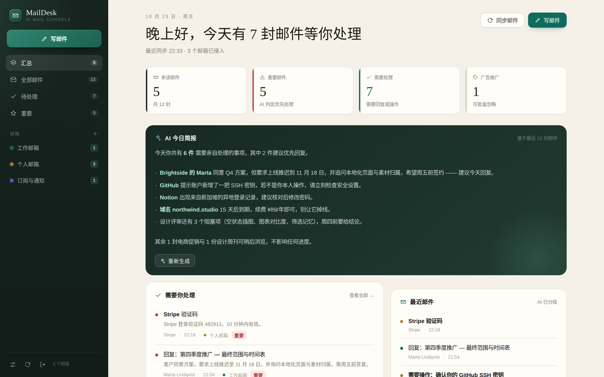
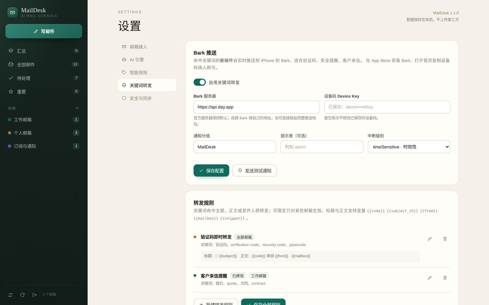

# MailDesk AI · 邮件管理台

一个可以自己部署的 Web 邮件客户端：统一接入多个邮箱，自动把英文邮件译成中文，用 AI 判断轻重缓急，可按自定义规则提炼内容，还能把验证码一类的邮件实时转发到手机 Bark。前端 Vue 3，后端 Go，**打包成单个可执行文件，内置全部前端资源**，数据只存在本机。



---

## 功能

| 能力 | 说明 |
| --- | --- |
| 多邮箱接入 | 任意支持 IMAP / SMTP 的邮箱，内置 Gmail、Outlook、QQ、163、126、阿里企业邮、iCloud 预设 |
| 发件人头像 | 邮件列表显示稳定的首字母头像，中英文发件人均自动生成，同一发件人始终保持相同配色 |
| 自定义 AI 接口 | OpenAI 兼容协议，Base URL / API Key / 模型全部可填（OpenAI、DeepSeek、Moonshot、one-api、Ollama…） |
| 英文邮件翻译 | 从 HTML 中提取可见文字后翻译为纯文本，自动忽略脚本、样式与隐藏内容；阅读页可在「译文 / 网页原文」间切换，原 HTML 排版不受翻译影响 |
| 自定义规则 | 命中关键词、发件人或收件人后，用你的提示词让 AI 提炼，结果以卡片形式展示在邮件页 |
| 关键词转发 Bark | 命中关键词的新邮件实时推送到手机 Bark，自动识别验证码，可限定邮箱、自定义标题与正文模板 |
| 浏览器 Web Push | 新邮件到达时发送系统通知，iOS / Android PWA 关闭后仍可收到；设置页按钮触发通知权限申请，支持多设备与测试通知 |
| 首页汇总 | 未读 / 重要 / 待处理 / 广告四项统计，AI 今日简报，按邮箱分组概览 |
| AI 分级 | 每封邮件自动生成一句话摘要、重要度（高/中/低）、是否需要处理、是否广告、分类 |
| 待处理闭环 | 阅读页一键「标记为已处理」（可撤销），待处理计数与首页清单即时更新；打开邮件不会被误判为已处理 |
| Markdown 排版 | AI 简报与规则结果按 Markdown 渲染，支持标题、列表、表格、代码块与链接；邮件译文保留纯文本段落，不改动原 HTML |
| 广告白名单 | 设置里填写完整邮箱（精确匹配）或域名（含子域）；单封可点「不是广告」纠正误判，广告列表还支持「全部忽略」，忽略后不计入统计且仍可在全部邮件中找到 |
| 搜索 | 主题、发件人、正文、译文、摘要全文检索 |
| 写邮件 | 选择发件邮箱、抄送、AI 润色正文、SMTP 发送 |
| 登录保护 | 单一访问密钥；同一 IP 连续 3 次错误即锁定，锁记录只在内存中，**重启程序才解锁** |
| 桌面 + 手机 | 桌面三栏布局，手机抽屉式导航与列表/阅读切换，适配 390px 起 |

暂不包含（可后续扩展）：附件上传与下载、收件箱之外的文件夹（已发送/自定义文件夹）、多用户与权限。

---

## 快速开始

到 [GitHub Releases](https://github.com/zhf883680/MailDesk/releases) 下载对应平台的压缩包，解压后直接运行：

| 系统 | 发布包 | 运行文件 |
| --- | --- | --- |
| Windows 64 位 | `maildesk-windows-amd64.zip` | `maildesk.exe` |
| macOS Apple 芯片 | `maildesk-darwin-arm64.tar.gz` | `maildesk` |
| macOS Intel | `maildesk-darwin-amd64.tar.gz` | `maildesk` |
| Linux x86_64 | `maildesk-linux-amd64.tar.gz` | `maildesk` |
| Linux ARM64 | `maildesk-linux-arm64.tar.gz` | `maildesk` |

发布包附有 `SHA256SUMS.txt` 可用于校验。源码仓库的 `bin/` 目录也保留了一份预编译文件，可用根目录的 `start.sh` / `start.bat` 一键启动；自行交叉编译见下文「从源码构建」。

### Windows

双击 `maildesk.exe`，或在该目录打开命令行运行：

```bat
maildesk.exe -addr :8080 -data .\data
```

### macOS / Linux

```bash
chmod +x maildesk
./maildesk -addr :8080 -data ./data
```

启动后浏览器打开 <http://localhost:8080>。

### Docker

```bash
docker run -d --name maildesk \
  -p 8080:8080 \
  -v "$PWD/data:/data" \
  --restart unless-stopped \
  ghcr.io/zhf883680/maildesk:latest
```

镜像由 GitHub Actions 构建并推送到 GHCR，支持 `linux/amd64` 与 `linux/arm64`；数据持久化在挂载的 `data/` 目录。

首次启动会自动生成 `data/` 目录，控制台会打印访问地址与默认密钥。

### 首次登录

默认访问密钥：**`admin123`**

登录后立刻到 **设置 → 安全与同步** 改成自己的密钥（至少 6 位）。密钥只保存加盐哈希，程序无法找回；遗忘时见文末「重置密钥」。

---

## 添加邮箱

进入 **设置 → 邮箱接入 → 添加邮箱**，填邮箱地址后系统会自动套用对应服务商的服务器配置，只需再填密码/授权码。

> 绝大多数邮箱不接受「登录密码」直连，需要使用**授权码 / 应用专用密码**：
> - **QQ 邮箱**：设置 → 账户 → 开启 IMAP/SMTP 服务 → 生成授权码（16 位）
> - **网易 163 / 126**：设置 → POP3/SMTP/IMAP → 开启 IMAP → 新增授权密码
> - **Gmail**：需先在 Google 账户开启两步验证，再创建「应用专用密码」
> - **Outlook**：账户安全 → 高级安全选项 → 应用密码（若组织禁用了基本认证，需管理员开启 IMAP）
> - **企业邮箱**：向管理员确认 IMAP/SMTP 地址与端口

保存后程序会立即同步一次收件箱；也可点行尾的刷新图标手动同步。同步失败的原因会显示在邮箱卡片上。

常用服务器参数：

| 服务商 | IMAP | SMTP |
| --- | --- | --- |
| Gmail | imap.gmail.com:993 SSL | smtp.gmail.com:465 SSL |
| Outlook | outlook.office365.com:993 SSL | smtp.office365.com:587 STARTTLS |
| QQ / Foxmail | imap.qq.com:993 SSL | smtp.qq.com:465 SSL |
| 163 | imap.163.com:993 SSL | smtp.163.com:465 SSL |
| 126 | imap.126.com:993 SSL | smtp.126.com:465 SSL |
| 阿里企业邮 | imap.aliyun.com:993 SSL | smtp.aliyun.com:465 SSL |
| iCloud | imap.mail.me.com:993 SSL | smtp.mail.me.com:587 STARTTLS |

---

## 配置 AI

**设置 → AI 引擎**：

| 字段 | 说明 |
| --- | --- |
| 接口地址 | 填到 `/v1` 即可，程序自动补 `/chat/completions`；也可直接填完整地址 |
| API Key | 保存后只显示掩码，留空表示不修改 |
| 模型 | 例如 `gpt-4o-mini`、`deepseek-chat`、`qwen-plus` |
| 温度 | 建议 0.2 ~ 0.3 |
| 正文截断长度 | 送给模型的正文上限，默认 6000 字符，控制成本 |

常见写法：

```
OpenAI        https://api.openai.com/v1          gpt-4o-mini
DeepSeek      https://api.deepseek.com/v1        deepseek-chat
Moonshot      https://api.moonshot.cn/v1         moonshot-v1-8k
one-api/中转   https://你的域名/v1                 按中转配置填写
本地 Ollama   http://127.0.0.1:11434/v1          qwen2.5:7b
```

填好后点「测试连接」，返回「AI 接口连通正常」即可。之后每封新邮件会自动走三步：

1. **翻译**：判断为英文时从 HTML 提取可见正文，按原段落换行译为纯文本，主题单独翻译；原始 HTML 完整保留用于「网页原文」。由「翻译方式」决定是收信时自动执行还是阅读时点击触发；
2. **分级**：一句话摘要 + 重要度 + 是否需处理 + 是否广告 + 分类；
3. **规则**：逐条匹配你配置的智能规则，命中则用对应提示词处理。

AI 处理是后台队列（3 并发），界面每几秒自动刷新状态。失败会在邮件页显示原因，可点「AI 重新分析」重试。

> 费用提示：英文邮件默认消耗 3 次请求（正文翻译 + 主题翻译 + 分级），非英文邮件为 1 次；命中的规则再按条数增加。可通过减少正文截断长度、关闭翻译或分级来降本。

---

## 智能规则

**设置 → 智能规则 → 新建规则**。

- **关键词**：任一命中即可，逗号分隔，匹配主题 + 正文 + 发件人
- **发件人包含 / 收件人包含**：可只针对某个客户域或某个收件地址
- **自定义提示词**：支持变量 `{{subject}}`、`{{from}}`、`{{to}}`、`{{date}}`、`{{body}}`、`{{summary}}`、`{{translation}}`；不写变量时会自动附上邮件内容

示例：

| 规则 | 关键词 | 提示词 |
| --- | --- | --- |
| 客户询价提取 | `quote, pricing, 报价, 询价` | 提取客户公司、需求内容、预算区间、期望交付时间，用条目输出，未提及写「未提及」 |
| 账单信息提取 | `invoice, 账单, receipt` | 提取金额（含币种）、到期日、账单周期、付款方式 |
| 面试邀约跟进 | `interview, 面试` | 提取公司、岗位、面试时间、面试方式，并给出一句回复建议 |

规则结果在邮件页以彩色卡片展示，卡片标题即规则名称。修改规则只影响之后的新邮件；对旧邮件可点邮件右上角的 ✦ 重新分析。


---

## 关键词转发到 Bark

收到验证码、登录提醒、客户询价这类邮件时，可以立刻推一条通知到 iPhone 上的 [Bark](https://bark.day.app)。

### 配置

1. App Store 安装 **Bark**，打开 App，首页会显示一串设备码（形如 `AbCdEf123456...`），点一下复制。
2. 打开 MailDesk 的 **设置 → 关键词转发**，把设备码填进「设备码 Device Key」。
3. 保持「Bark 服务器」为 `https://api.day.app`（自建服务器请改成自己的地址）。
4. 打开「启用关键词转发」，点 **保存配置**，再点 **发送测试通知**。手机几秒内收到「MailDesk 测试通知」即成功。
5. 到下方「转发规则」新建规则，例如关键词填 `验证码, verification code, 动态码`。



### 规则说明

| 项 | 说明 |
| --- | --- |
| 关键词 | 任一命中即可，匹配主题、正文、发件人，不区分大小写 |
| 发件人包含 | 可选，例如 `@stripe.com`，只转发特定来源 |
| 生效邮箱 | 不选表示全部邮箱；可只勾选工作邮箱等 |
| 标题模板 | 留空用邮件主题；常用 `验证码 · {{subject_zh}}` |
| 正文模板 | 留空时自动提取验证码；可用下方变量自定义 |

模板变量：

| 变量 | 含义 |
| --- | --- |
| `{{code}}` | 自动识别出的验证码（4–8 位数字，优先匹配「验证码 / code / OTP」上下文） |
| `{{subject}}` / `{{subject_zh}}` | 邮件主题（原文 / 中文译文） |
| `{{from}}` / `{{from_addr}}` | 发件人名称 / 地址 |
| `{{mailbox}}` | 收件邮箱名称 |
| `{{snippet}}` | 正文摘要（160 字） |
| `{{date}}` | 邮件时间 |
| `{{category}}` / `{{summary}}` | AI 分类与摘要（若已开启 AI） |

正文模板留空时的默认内容：检测到验证码就推送「验证码：482913 + 发件人」，没有验证码则推送「发件人 + 摘要」。

### 行为细节

- **每封新邮件只推送一次**，同一邮件命中多条规则时使用第一条。
- 首次添加邮箱时会拉取历史邮件，这些旧邮件**不会**推送，避免一次收到几十条通知（只推送 30 分钟内到达的）。
- 启用转发后，后台至少**每分钟**同步一次（即使同步间隔设得更大），验证码通常 1 分钟内到手机；关闭转发后恢复按设定间隔同步。
- 推送失败会在邮件详情页显示原因，可点「重新推送」重试；邮件列表会显示「已推送」标记。
- 通知分组固定为「MailDesk」，可在 Bark App 内单独设置铃声与静音。
- 设备码以明文保存在 `data/config.json`，接口返回时会做掩码处理。

---

## 日常使用

- **汇总**：今日简报、四项统计（点击直达筛选）、需要你处理、最近邮件、按邮箱概览。
- **列表**：按今天/昨天/本周/更早分组；未读加粗；标签显示重要、待处理、广告、已翻译、规则结果数量。
- **阅读**：AI 摘要面板 → 规则卡片 → 正文（译文 / 网页原文）→ 英文原文折叠区；右上角可星标、标未读、重新分析、回复、删除（删除前需二次点击确认）。
- **搜索**：左上搜索框，输入即搜（防抖 260ms），跨全部邮箱检索主题、正文、译文与摘要。
- **写邮件**：左下「写邮件」，可切换发件邮箱、抄送、「AI 润色」优化正文，`Ctrl/⌘ + Enter` 发送。
- **同步**：每 5 分钟自动同步，也可点列表右上角刷新手动触发。

---

## 浏览器通知（Web Push）

**设置 → 浏览器通知**，点击 **开启 Web Push**。必须由你主动点击，浏览器或 iOS 才会显示系统通知权限申请。

运行条件：

- 通过 **HTTPS** 访问 MailDesk（`localhost` 调试除外）。
- iPhone / iPad 需要 iOS 16.4 或更高版本。
- iOS 必须先用 Safari 打开 MailDesk，再通过「分享 → 添加到主屏幕」安装，并从主屏幕启动。

开启后，后台发现新邮件会发送 Web Push。标题优先使用中文主题，正文显示发件人与摘要；点击通知会直接打开对应邮件。首次添加邮箱时同步到的历史邮件不会通知，同一封邮件只推送一次。MailDesk 正在前台显示时不重复弹系统通知。

通知设置支持：

- 多设备分别订阅，服务端可同时推送。
- 「发送测试通知」验证链路；测试通知即使 MailDesk 正在前台也会显示，便于确认系统通知是否正常。
- 关闭本设备通知并清理服务端订阅。
- 浏览器返回 403 / 404 / 410 的失效订阅自动移除；测试通知会先刷新当前设备的 VAPID 订阅。
- 新 Service Worker 会立即激活，避免旧版本继续执行前台静默逻辑。

Web Push 使用 VAPID 与端到端加密载荷；订阅和密钥仅保存在本机 `data/config.json`。通知仍会经过浏览器厂商的推送服务转发，这是 Web Push 协议的正常链路。

---

## 数据与安全

```
data/
├── config.json      # 邮箱、AI、规则、Bark 设备码、Web Push 密钥/订阅、登录密钥哈希
├── .secret          # AES-256-GCM 密钥（邮箱密码用它加密）
└── emails/
    └── <id>.json    # 各邮箱最近 600 封邮件的缓存与 AI 结果
```

- 邮箱密码使用 AES-256-GCM 加密后存储，`.secret` 权限为 0600。
- 服务默认监听 `:8080`（所有网卡）。只想本机访问：`-addr 127.0.0.1:8080`。
- 局域网/公网访问时，密钥与邮件内容走明文 HTTP，**建议放在 HTTPS 反向代理之后**（Nginx / Caddy）。
- 备份：直接复制整个 `data/` 目录（`.secret` 必须一起备份，否则密码无法解密）。
- 删除某邮箱会同时删除其本地缓存，不影响服务器上的邮件；删除单封邮件会移入服务器垃圾箱。

### 登录锁定机制

- 同一 IP 连续 3 次输错密钥 → 该 IP 立即锁定，正确密钥也拒绝（返回 423）。
- 锁定记录只存在内存里，**重启程序才会清除**，界面上没有任何解锁入口。
- 锁定按来源 IP 计算，不影响其他设备；反向代理场景下所有请求会呈现为代理 IP，请注意。

### 重置密钥

```bash
# 停掉程序后执行，然后重新启动
./bin/maildesk-linux-amd64 -data ./data -key 新的密钥
```

或删除 `data/config.json` 里的 `login_key_hash` 字段，重启后恢复默认 `admin123`。

---

## 运行日志

程序将版本、同步和 Web Push 日志输出到标准输出，可直接用 `docker logs`、systemd journal 或启动终端查看。典型日志包括：

```text
[startup] MailDesk v1.4.1 starting addr=:120 data=/data demo=false
[push] 服务已初始化 subscriptions=1 enabled=true
[sync] start mailbox=work email=me@example.com last_sync=2026-10-26T11:00:00+08:00 force=false
[sync] complete mailbox=work fetched=40 added=2 ai_queued=2 first_sync=false
[push] 开始发送新邮件通知 id=work:123 subscriptions=1
[push] 请求完成 target=https://push.example.com status=201 duration=245ms
[push] 新邮件通知完成 id=work:123 success=1
```

日志不会输出邮件正文、VAPID 私钥或完整推送订阅 URL；订阅地址仅记录到域名级别。

---

## 命令行参数

| 参数 | 默认 | 说明 |
| --- | --- | --- |
| `-addr` | `:8080` | 监听地址，如 `:9000`、`127.0.0.1:8080` |
| `-data` | `data` | 配置与邮件缓存目录 |
| `-demo` | 关闭 | 演示模式，载入 3 个示例邮箱与 11 封样例邮件，不连接真实邮箱 |
| `-key` | 空 | 设置访问密钥后退出（用于重置） |

演示模式很适合先看效果：

```bash
./bin/maildesk-linux-amd64 -demo -data ./demo-data -addr :8090
```

---

## 从源码构建

需要 Go 1.25+、Node 20+。

```bash
# 1. 构建前端
cd source/web
npm install            # 或 pnpm install
npm run build          # 或 pnpm build；产物在 web/dist，会被后端 embed

# 2. 编译后端（单文件，含前端）
cd ..
go build -trimpath -ldflags "-s -w" -o maildesk .

# 3. 运行
./maildesk -addr :8080 -data ./data
```

交叉编译示例：

```bash
CGO_ENABLED=0 GOOS=windows GOARCH=amd64 go build -trimpath -ldflags "-s -w" -o maildesk.exe .
CGO_ENABLED=0 GOOS=darwin  GOARCH=arm64 go build -trimpath -ldflags "-s -w" -o maildesk-mac .
```

### 自动构建与发布

推送代码后由 GitHub Actions 自动完成前端构建、跨平台编译与发布：

| 触发方式 | 行为 |
| --- | --- |
| 推送到 `main` / `master` | 构建 5 个平台的压缩包，发布或更新 `v<当前版本>` Release（版本号取自 `source/main.go` 的 `appVersion`），已存在的同名文件会被覆盖 |
| 推送 `v*` 标签 | 构建并发布同名 Release，例如 `git tag v1.3.4 && git push origin v1.3.4` |
| 手动运行 workflow | 按所选分支执行同样的构建与发布 |

工作流文件为 `.github/workflows/release.yml`。发布物包括各平台 `.tar.gz` / `.zip`（内含可执行文件与 README）以及 `SHA256SUMS.txt`；Docker 镜像仍由 `.github/workflows/docker.yml` 单独构建并推送到 GHCR。

源码结构：

```
main.go     启动、参数、静态资源
config.go   配置、密码加密、登录密钥
store.go    邮件模型与本地缓存
imap.go     IMAP 收取与 MIME 解析
send.go     SMTP 发信
ai.go       AI 调用、翻译/分级/规则流水线
api.go      HTTP 接口、鉴权、IP 锁定、定时同步
demo.go     演示数据
web/        Vue 3 前端
```

---

## 常见问题

**IMAP 登录失败 / 认证失败**
多半是用了登录密码而非授权码；QQ、163、Gmail 必须用授权码。也可能是服务商未开启 IMAP，先去邮箱网页版设置里开启。

**同步很慢或超时**
首次同步会拉最近 40 封的完整正文，国内直连 Gmail/Outlook 可能较慢。可在「安全与同步」把每邮箱拉取封数改为 20，或配置代理。

**AI 一直显示「分析中」**
检查接口地址与 Key，点「测试连接」。部分中转不支持 `temperature` 或并发限制较低，可换模型或减少同步量。失败原因会显示在 AI 面板上。

**手机上打不开**
确保手机与电脑在同一网络，用电脑局域网 IP 访问，例如 `http://192.168.1.20:8080`，并允许防火墙放行端口。

**添加到 iPhone 主屏**
用 Safari 打开后用「分享 → 添加到主屏幕」，会以独立应用方式全屏运行（已内置 manifest 与图标）。从主屏切回、或从后台回到 app 时会自动重新拉取数据；在任何页面顶部下拉即可手动刷新，首页右上角也有刷新按钮。Web Push 也要求从主屏幕启动，并在「设置 → 浏览器通知」里手动点击授权。

**邮件正文显示为空白**
部分邮件是纯图片（如营销邮件）或只有附件，可切换到「网页原文」查看完整 HTML 渲染。

**端口被占用**
换端口启动：`./maildesk -addr :9000`。

---

版本 1.4.2 · 单机自部署 · 数据不出本机
